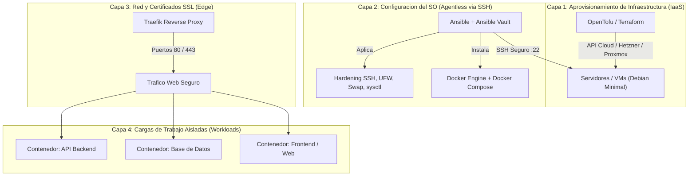

# Infraestructura como Código (IaC) — Flota de Servidores

Repositorio centralizado de **Infraestructura como Código (IaC)** y **GitOps** para el aprovisionamiento, configuración de sistema operativo, seguridad y despliegue de cargas de trabajo en servidores de producción y entornos de prueba.

Este proyecto implementa el **estándar de facto** de la industria:
* **IaaS / Aprovisionamiento:** OpenTofu (código HCL declarativo, agnóstico de proveedor).
* **Gestión de Configuración:** Ansible (agentless vía SSH, idempotente, hardening automatizado).
* **Gestión de Secretos:** Ansible Vault / SOPS (cifrado AES-256 en repositorio).
* **Orquestación de Cargas:** Docker Engine + Docker Compose (principio del *Host Inmaculado*).
* **Edge / Ingress:** Traefik con TLS automático (Let's Encrypt / ZeroSSL).
* **Integración Continua:** GitHub Actions para validación estática y linting de código.

Para la fundamentación técnica detallada y justificación de cada herramienta, consultar:
[docs/estandar-iac-servidores.md](docs/estandar-iac-servidores.md)

---

## 1. Arquitectura del Sistema



### El Principio del Host Inmaculado
En los servidores administrados por este repositorio **nunca se instalan lenguajes de programación, librerías de aplicación ni bases de datos directamente sobre el sistema operativo**.
* El host ejecuta únicamente: kernel Linux, OpenSSH endurecido, firewall UFW y el motor Docker.
* Todas las aplicaciones y bases de datos corren en contenedores aislados. Esto erradica colisiones de dependencias, permite actualizaciones del sistema base sin riesgo de romper servicios y facilita migraciones instantáneas de servidor.

---

## 2. Estructura del Repositorio

```text
infraestructura/
├── README.md                           # Documentacion principal del proyecto
├── .gitignore                          # Exclusiones estrictas (.tfstate, secretos, llaves)
├── docs/
│   └── estandar-iac-servidores.md     # Dosier de arquitectura y estandares tecnicos
├── tofu/                               # Aprovisionamiento de infraestructura (IaaS)
│   ├── modules/                        # Modulos reutilizables (redes, compute, storage)
│   └── environments/
│       └── prod/                       # Entorno de produccion
│           ├── main.tf                 # Recursos principales (instancias, subnets, SSH)
│           ├── variables.tf            # Definicion de variables y tipos
│           └── outputs.tf              # Salidas exportadas (IP publica, IP privada)
├── ansible/                            # Configuracion de sistema operativo (Agentless)
│   ├── ansible.cfg                     # Configuracion de ejecucion, SSH multiplexing
│   ├── inventories/
│   │   └── prod/
│   │       ├── hosts.yaml              # Inventario de servidores y parametros de conexion
│   │       └── group_vars/
│   │           └── all.yaml            # Variables globales (puerto SSH, swap, Docker)
│   ├── playbooks/
│   │   └── site.yaml                   # Playbook maestro de ejecucion
│   └── roles/
│       ├── swap/                       # Creacion y activacion persistente de swapfile
│       ├── base_hardening/             # UFW, Fail2ban, endurecimiento de SSH
│       └── docker/                     # Instalacion oficial de Docker Engine y daemon.json
├── workloads/                          # Cargas de trabajo en contenedores (Docker Compose)
│   ├── edge/                           # Proxy perimetral y terminacion SSL (Traefik)
│   │   └── docker-compose.yaml
│   └── monitoring/                     # Prometheus, Node Exporter, Grafana (opcional)
└── .github/
    └── workflows/
        └── ci.yaml                     # Pipeline de validacion sintactica (yamllint, tofu fmt)
```

---

## 3. Politica Estricta de Seguridad y Secretos

1. **Estado de OpenTofu (`.tfstate`):**
   * Está estrictamente excluido en el `.gitignore`.
   * Para entornos reales de producción, configurar el backend remoto en `tofu/environments/prod/main.tf` utilizando un bucket S3 compatible con cifrado en reposo (Cloudflare R2, AWS S3 o MinIO) y bloqueo distribuido.
2. **Secretos de Ansible:**
   * Cualquier contraseña, token o variable sensible dentro de `group_vars/` debe ser cifrada con:
     ```bash
     ansible-vault encrypt_string 'mi_secreto' --name 'db_password'
     ```
   * Nunca commitear archivos de contraseña (`.vault-pass`) al repositorio.
3. **Llaves SSH:**
   * Únicamente se versionan llaves públicas (`*.pub`). Las llaves privadas permanecen en local o se inyectan en CI/CD como secretos protegidos.

---

## 4. Guía de Ejecución Rápida

### Fase 1: Aprovisionar Infraestructura (OpenTofu)
```bash
cd tofu/environments/prod
export TF_VAR_hcloud_token="tu-token-aqui"
tofu init
tofu plan -out=tfplan
tofu apply tfplan
```

### Fase 2: Configurar y Endurecer el Sistema Operativo (Ansible)
```bash
cd ../../../ansible
# Probar conectividad con los hosts del inventario
ansible all -m ping

# Ejecutar el playbook maestro de configuracion
ansible-playbook playbooks/site.yaml
```

### Fase 3: Desplegar el Proxy Perimetral (Workloads)
```bash
cd ../workloads/edge
docker compose up -d
```
