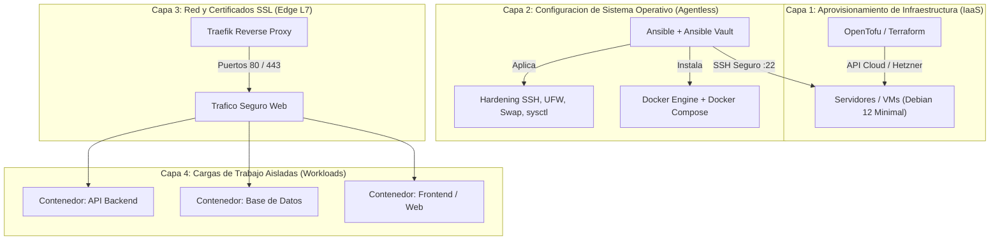
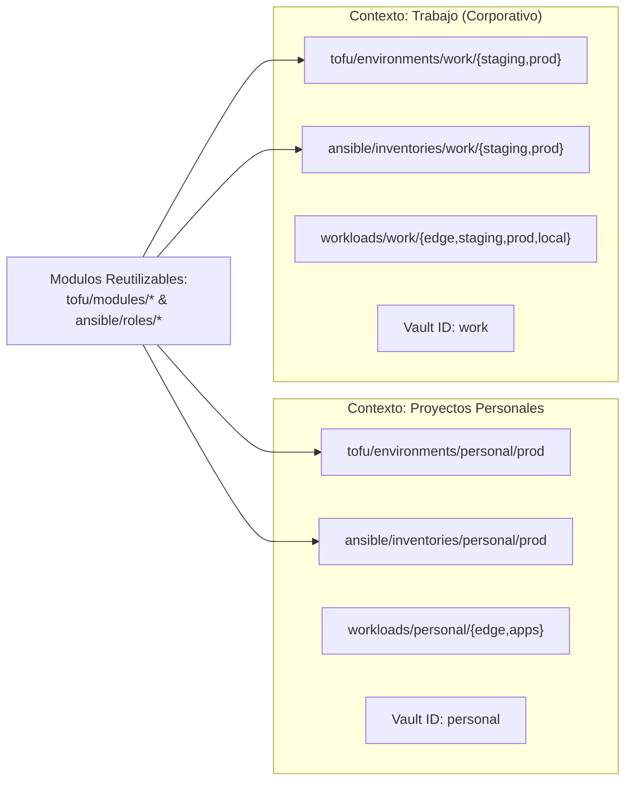

# 01 — Arquitectura General y Multi-Contexto

[Volver al Índice General](00-indice-general.md) | [Siguiente: Aprovisionamiento con OpenTofu](02-aprovisionamiento-tofu.md)

---

## 1. Filosofía de Ingeniería y Separación de Responsabilidades

Este repositorio traslada los principios de la ingeniería de software y la nube (**GitOps**, **Idempotencia**, **Inmutabilidad** y **Separación de Responsabilidades**) a la administración de servidores físicos y virtuales.

El sistema desacopla la infraestructura en capas estrictas e independientes:

### El Principio del Host Inmaculado
En los servidores gobernados por esta arquitectura **nunca se instalan lenguajes de programación, librerías de aplicación ni bases de datos directamente sobre el sistema operativo**.
* El sistema base únicamente ejecuta: el kernel Linux, OpenSSH endurecido, cortafuegos UFW y el motor Docker Engine.
* Todas las aplicaciones y dependencias corren en contenedores aislados. Esto erradica colisiones de librerías dinámicas, permite actualizaciones del sistema base sin riesgo de romper servicios y facilita migraciones instantáneas de servidor.

---

## 2. Topología Multi-Contexto: Trabajo vs. Proyectos Personales

Para evitar la fragmentación de repositorios sin comprometer la seguridad ni mezclar datos confidenciales, la infraestructura se divide en dos contextos independientes:

### Matriz Comparativa de Contextos

| Parámetro | Contexto: Proyectos Personales | Contexto: Trabajo (Corporativo) |
|---|---|---|
| **Ambientes Soportados** | Producción (`prod`) | Producción (`prod`), Staging (`staging`) y Local (`local`) |
| **Identidad de Cifrado** | `personal` (`--vault-id personal@...`) | `work` (`--vault-id work@...`) |
| **Dominio y Certificados** | Dominios personales (ej. `personal.dev`) | Dominios corporativos (ej. `empresa.com`) |
| **Backend de Estado Tofu** | Bucket S3 personal / Cloudflare R2 | Bucket S3 corporativo con cifrado KMS |
| **Dimensionamiento Servidor** | Instancias tipo `cpx11` (2 vCPU, 2 GB RAM) | Instancias tipo `cpx21` / `cpx31` (4-8 GB RAM) |

---

## 3. Matriz de Ambientes del Contexto Trabajo

| Dimensión Técnica | Ambiente Local (`local`) | Ambiente Staging (`staging`) | Ambiente Producción (`prod`) |
|---|---|---|---|
| **Destinatarios** | Desarrolladores en sus estaciones de trabajo | Equipo QA y despliegues de validación | Usuarios finales y clientes |
| **Aprovisionamiento IaaS** | No aplica (Docker Compose local) | OpenTofu (`work-net-staging`, VM `cpx21`) | OpenTofu (`work-net-prod`, VM `cpx31`) |
| **Gestión de Configuración** | Makefile (`make dev-up`) | Ansible (`inventories/work/staging`) | Ansible (`inventories/work/prod`) |
| **Red y Exposición** | `localhost` (puertos directos 5432, 6379) | Red interna + Traefik con TLS en staging | Red interna + Traefik con TLS en prod |
| **Políticas de Respaldo** | No aplica (volúmenes locales efímeros) | Snapshots de disco programados | Snapshots diarios + respaldos a bucket S3 |

---

## 4. Fronteras Técnicas y No-Duplicación

Cada herramienta del ecosistema tiene un alcance estricto:
1. **OpenTofu:** Se comunica exclusivamente con la API de nube para crear servidores y redes privadas. No configura software dentro de la máquina.
2. **Ansible:** Se conecta mediante SSH a la IP generada por OpenTofu. Aplica configuración de kernel, UFW, swap e instala Docker. No crea servidores ni despliega código de negocio.
3. **UFW (Firewall L3/L4):** Filtra paquetes de red a nivel de kernel. Solo admite tráfico en los puertos 22, 80 y 443.
4. **Traefik (Proxy Inverso L7):** Inspecciona cabeceras HTTP, enruta por nombre de dominio y administra certificados TLS automáticos.
5. **Docker Compose:** Ejecuta y aísla los contenedores de aplicación.
