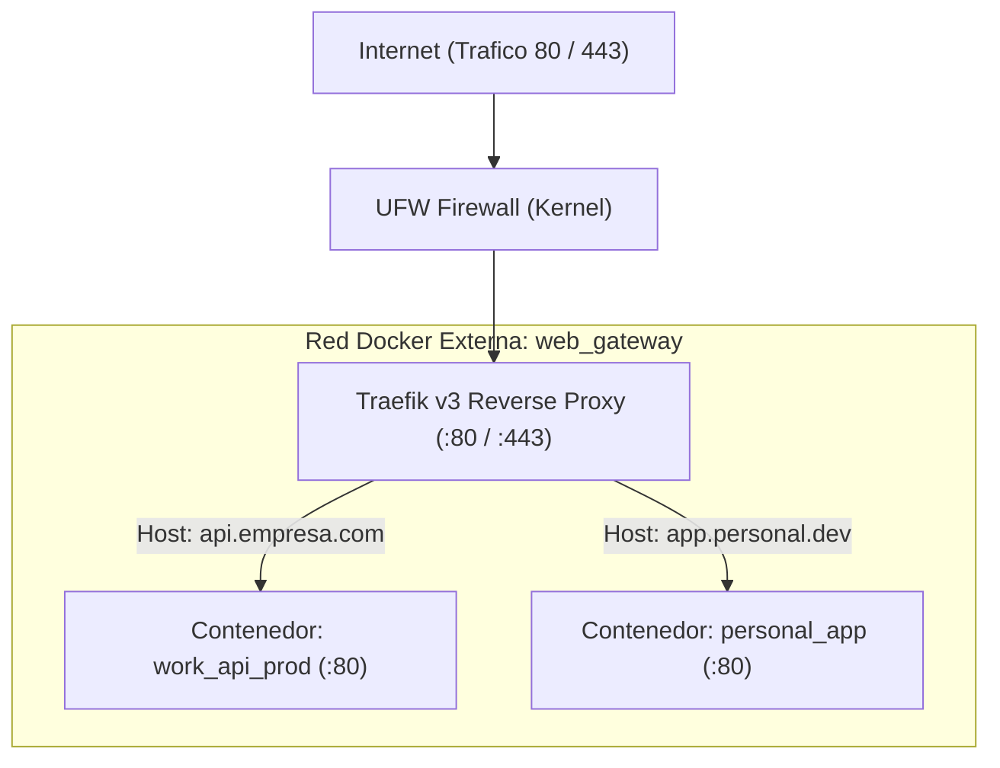

# 05 — Cargas de Trabajo y Enrutamiento Perimetral Edge

[Volver al Índice General](00-indice-general.md) | [Anterior: Entorno Local para Equipos](04-entorno-local-desarrolladores.md) | [Siguiente: Seguridad y Políticas](06-seguridad-y-politica-de-secretos.md)

---

## 1. Modelo de Cargas de Trabajo con Docker Compose

Todas las aplicaciones, APIs y servicios se ejecutan de manera aislada utilizando **Docker Compose**.
* No se exponen puertos directamente al host salvo los puertos web universales `80` (HTTP) y `443` (HTTPS) que pertenecen a Traefik.
* Todos los contenedores de aplicación se conectan a una red puente externa predefinida llamada `web_gateway`.



---

## 2. Arquitectura del Proxy Perimetral Traefik v3

Traefik actúa como el **Ingress Controller** de la máquina. Lee en tiempo real el socket de Docker (`/var/run/docker.sock`) y detecta cuándo un nuevo contenedor se inicia o se detiene.

### Características Implementadas:
1. **Redirección Forzada a HTTPS:** Todo tráfico recibido en el puerto 80 es redirigido con código HTTP 301 hacia el puerto seguro 443.
2. **Generación y Renovación de TLS (Let's Encrypt):** Traefik solicita automáticamente certificados criptográficos SSL a Let's Encrypt y los almacena en el archivo seguro `/acme.json` (con permisos `0600`).
3. **Aislamiento por Defecto:** Traefik tiene la directiva `exposedByDefault: false`. Un contenedor **nunca será expuesto a Internet** a menos que declare explícitamente la etiqueta `traefik.enable=true`.

---

## 3. Catálogo de Etiquetas de Enrutamiento (Docker Labels)

Para exponer cualquier contenedor a través de Traefik de forma segura, se declaran las siguientes etiquetas en el archivo `docker-compose.yaml` del servicio:

| Etiqueta Docker | Función Técnica | Ejemplo de Configuración |
|---|---|---|
| `traefik.enable` | Habilita el enrutamiento para el servicio | `"true"` |
| `traefik.http.routers.<name>.rule` | Regla de coincidencia de dominio (Host) | `"Host(\`api.empresa.com\`)"` |
| `traefik.http.routers.<name>.entrypoints` | Punto de entrada permitido | `"websecure"` |
| `traefik.http.routers.<name>.tls` | Activa cifrado TLS/SSL | `"true"` |
| `traefik.http.routers.<name>.tls.certresolver` | Asigna el emisor de certificados | `"letsencrypt"` |
| `traefik.http.services.<name>.loadbalancer.server.port` | Puerto interno en el que escucha el contenedor | `"80"` o `"3000"` |

---

## 4. Estructura de Cargas de Trabajo

```text
workloads/
├── personal/
│   ├── edge/                          # Traefik v3 para proyectos personales
│   │   ├── docker-compose.yaml
│   │   └── data/traefik.example.yml
│   └── apps/                          # Aplicaciones de proyectos propios
│       └── docker-compose.example.yaml
│
└── work/
    ├── edge/                          # Traefik v3 corporativo
    │   ├── docker-compose.yaml
    │   └── data/traefik.example.yml
    ├── staging/                       # Cargas de pre-produccion
    │   └── docker-compose.yaml
    ├── prod/                          # Cargas de produccion corporativa
    │   └── docker-compose.yaml
    └── local/                         # Pila local para el equipo (Postgres, Redis, RabbitMQ)
        ├── docker-compose.local.yml
        ├── .env.example
        └── Makefile
```

---

## 5. Procedimiento Operativo de Despliegue en Servidor

### Paso 1: Inicializar el Proxy Perimetral (Traefik)
```bash
cd /opt/traefik  # O la ruta sincronizada en el servidor
# Asegurar que acme.json tiene permisos 0600
chmod 600 data/acme.json
docker compose up -d
```

### Paso 2: Desplegar o Actualizar una Aplicación
```bash
cd /opt/workloads/app
# Descargar nuevas imagenes si aplica
docker compose pull
# Levantar en segundo plano recreando contenedores modificados
docker compose up -d --remove-orphans
```
Traefik detecta la nueva instancia inmediatamente sin necesidad de recargar la configuración ni reiniciar el proxy perimetral.
