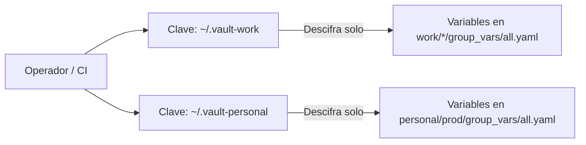

# 06 — Seguridad, Políticas de Secretos y Cumplimiento

[Volver al Índice General](00-indice-general.md) | [Anterior: Cargas de Trabajo y Edge](05-cargas-de-trabajo-y-edge.md)

---

## 1. Principio Fundamental: Cero Secretos en Repositorio

En este proyecto rige una directriz estricta e inviolable: **ninguna contraseña, token de API, clave privada SSH o archivo de credenciales en texto plano puede ser comiteado en el repositorio Git**.

Cualquier credencial sensible debe ser gestionada mediante una de las tres vías seguras:
1. **Cifrada con Ansible Vault** si reside dentro del árbol de Git.
2. **Inyectada en tiempo de ejecución** mediante variables de entorno en pipelines de CI/CD (GitHub Actions Secrets).
3. **Almacenada en un backend remoto cifrado** en el caso del estado de OpenTofu (`.tfstate`).

---

## 2. Gestión de Secretos con Ansible Vault Multi-ID

Para evitar que un desarrollador con acceso al contexto personal pueda descifrar secretos corporativos (o viceversa), se implementa un modelo de identidades de cifrado múltiples:



### Reglas de Operación con Vault
* Las contraseñas de las bóvedas nunca se guardan en el repositorio. Se configuran mediante archivos locales ignorados por Git (`~/.vault-work`, `~/.vault-personal`) o la variable de entorno `ANSIBLE_VAULT_PASSWORD_FILE`.
* Toda variable secreta se cifra mediante formato de cadena individual:
  ```bash
  ansible-vault encrypt_string 'contrasena_real' --name 'db_password' --vault-id work@~/.vault-work
  ```
* El resultado es un bloque seguro AES-256 que puede versionarse sin peligro en Git:
  ```yaml
  db_password: !vault |
            $ANSIBLE_VAULT;1.2;AES256;work
            31343732626231646231343936616461663435373333333830303865326535313936316238356163
  ```

---

## 3. Protección del Estado de OpenTofu (`.tfstate`)

Los archivos `.tfstate` contienen un mapa detallado de la infraestructura creada y, frecuentemente, valores sensibles en texto plano devueltos por la API del proveedor.

> [!CAUTION]
> El estado de OpenTofu nunca debe almacenarse localmente en repositorios públicos.
* Está bloqueado en `.gitignore` mediante reglas que cubren `*.tfstate`, `*.tfstate.*` y `*.tfstate.backup`.
* En producción se utiliza un backend S3 remoto (Cloudflare R2, AWS S3 o MinIO) con cifrado del lado del servidor habilitado y bloqueo distribuido mediante DynamoDB o S3 locking nativo.

---

## 4. Auditoría de Exclusiones en `.gitignore`

El archivo [`.gitignore`](../.gitignore) implementa una política de defensa en profundidad:

| Patrón Bloqueado | Categoría | Riesgo Mitigado |
|---|---|---|
| `*.tfstate*` | OpenTofu | Exposición de secretos y topología de red en texto plano |
| `*.tfvars`, `*.tfvars.json` | OpenTofu | Fuga de tokens de API y contraseñas de entrada |
| `.vault-pass*`, `*.vault-key` | Ansible | Fuga de la clave maestra de descifrado de las bóvedas |
| `*.pem`, `*.key`, `id_rsa*`, `id_ed25519*` | Criptografía | Fuga de llaves privadas SSH y certificados TLS |
| `.env`, `.env.*` (excepto `.env.example`) | Runtimes | Fuga de variables de entorno locales de bases de datos |
| `workloads/**/acme.json` | Edge | Exposición de certificados y llaves privadas TLS de Let's Encrypt |

---

## 5. Endurecimiento de Seguridad en Servidores (Host Hardening)

El rol [ansible/roles/base_hardening](../ansible/roles/base_hardening) aplica de forma obligatoria las siguientes directivas en cada servidor aprovisionado:

1. **Endurecimiento de SSH (`/etc/ssh/sshd_config`):**
   * `PermitRootLogin no`: Impide que atacantes realicen ataques de fuerza bruta directamente contra el usuario root.
   * `PasswordAuthentication no`: Cierra por completo la autenticación mediante contraseña. El acceso es exclusivamente posible con llaves criptográficas SSH (preferentemente `Ed25519`).
   * `X11Forwarding no`: Deshabilita el reenvío gráfico X11.
2. **Cortafuegos Perimetral (UFW):**
   * Política entrante: Bloqueo estricto por defecto (`deny`).
   * Puertos abiertos autorizados: Solo SSH (`22/tcp`), HTTP (`80/tcp`) y HTTPS (`443/tcp`).
   * Regla `limit` en puerto SSH para bloquear intentos repetitivos automatizados.
3. **Defensa contra Ataques de Fuerza Bruta (`fail2ban`):**
   * Supervisa los registros de autenticación del sistema y bloquea automáticamente las direcciones IP que superen el umbral de intentos fallidos.
4. **Protección contra Agotamiento de Recursos (Docker Logs):**
   * `/etc/docker/daemon.json` limita el tamaño máximo de registros por contenedor a 50 MB / 100 MB y mantiene un máximo de 3 a 5 rotaciones, evitando que una aplicación con fugas de logs sature la partición raíz del servidor.
