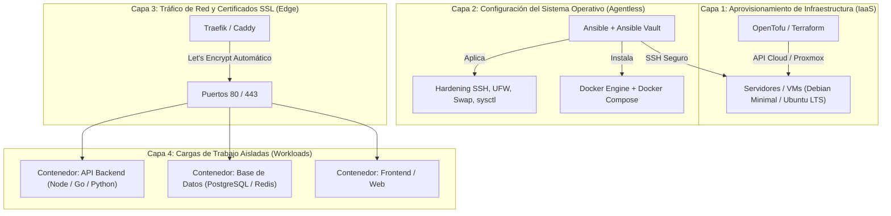

# Arquitectura de Infraestructura como Código (IaC) para Servidores — Estándar de la Industria

Este documento define la arquitectura técnica, herramientas, principios de seguridad y flujo operativo del **estándar de facto** de la industria para la gestión profesional de servidores.

Complementa la estrategia de estaciones de trabajo personales (gestionadas con Nix Flakes y Home Manager) estableciendo una frontera clara: **Nix para entornos locales y el estándar corporativo universal (OpenTofu + Ansible + Docker) para servidores**.

---

## 1. Filosofía de Ingeniería y Separación de Responsabilidades

La administración moderna de servidores desacopla las responsabilidades en capas estrictas e independientes:



### El Principio del Host Inmaculado
En el servidor **nunca se instalan lenguajes de programación, librerías de aplicación ni bases de datos directamente sobre el sistema operativo**.
* El sistema operativo host solo debe ejecutar: el kernel Linux, OpenSSH endurecido, firewall perimetral y el motor de contenedores (Docker/containerd).
* Todas las aplicaciones corren en contenedores aislados. Esto erradica colisiones de dependencias, permite actualizaciones del sistema base sin riesgo de romper aplicaciones y facilita migraciones instantáneas de servidor.

---

## 2. Catálogo Exhaustivo de Herramientas del Estándar de Facto

| Capa Técnica | Herramienta | Función Principal | Justificación Técnica de Elección |
|---|---|---|---|
| **Sistema Operativo** | **Debian Minimal** (o Ubuntu LTS) | Sistema base del servidor | Máxima estabilidad, soporte extendido (LTS), menor superficie de ataque y compatibilidad universal con cualquier proveedor de nube. |
| **Aprovisionamiento (IaaS)** | **OpenTofu** (o Terraform) | Creación de infraestructura | Código declarativo HCL. Crea VMs, VPCs, subnets, balanceadores y registros DNS en Hetzner, AWS, DigitalOcean o Proxmox de forma agnóstica. |
| **Gestión de Configuración** | **Ansible** | Configuración del SO por SSH | **Agentless** (cero daemons consumiendo RAM en el servidor). Idempotente y legible en YAML. Aplica hardening, usuarios y actualizaciones. |
| **Gestión de Secretos** | **Ansible Vault** / **SOPS** | Cifrado de credenciales | Cifrado AES-256 de claves y contraseñas dentro del repositorio Git. Se descifran únicamente en memoria durante el despliegue. |
| **Cargas de Trabajo** | **Docker Engine + Docker Compose** | Aislamiento de servicios | Estándar indiscutible para microservicios y bases de datos en configuraciones de 1 a 3 servidores. Despliegue reproducible vía `compose.yml`. |
| **Orquestación Clúster** | **K3s (Kubernetes Ligero)** | Cargas distribuidas | Distribución oficial de Kubernetes empaquetada en un binario de < 100 MB. Se utiliza solo si se requiere alta disponibilidad multi-nodo. |
| **Reverse Proxy / SSL** | **Traefik** (o Caddy) | Enrutamiento y TLS | Detección automática de contenedores mediante etiquetas Docker. Generación y renovación automática de certificados SSL con Let's Encrypt. |
| **Observabilidad (Métricas)** | **Prometheus + Grafana** | Telemetría del servidor | `Node Exporter` extrae métricas de CPU, RAM, disco y red; `Prometheus` las indexa y `Grafana` las visualiza en dashboards con alertas. |
| **Centralización de Logs** | **Loki + Vector** (o Promtail) | Agregación de registros | Centraliza los logs de contenedores y de `systemd-journald` para auditoría y depuración sin requerir acceso SSH a cada servidor. |
| **Automatización CI/CD** | **GitHub Actions** / **GitLab CI** | Pipelines de integración | Automatiza la ejecución de linters de Ansible (`ansible-lint`), construcción de imágenes Docker y despliegues por SSH ante cada `git push`. |

---

## 3. Estructura Estándar de Repositorio de Infraestructura (`infra-servers/`)

Para gestionar servidores en producción, se crea un repositorio Git independiente de los dotfiles personales:

```text
infra-servers/
├── ansible.cfg                 # Configuración de conexiones SSH (pipelining, timeouts)
├── inventory/
│   ├── production.ini          # IPs, usuarios y grupos de servidores de producción
│   └── staging.ini             # Servidores de pruebas / preproducción
├── group_vars/
│   ├── all/
│   │   ├── vars.yml            # Variables globales no sensibles (zonas horarias, paquetes base)
│   │   └── vault.yml           # Credenciales y tokens cifrados con Ansible Vault (AES-256)
│   ├── webservers/
│   │   └── vars.yml            # Parámetros específicos para nodos web (puertos, dominios)
│   └── dbservers/
│       └── vars.yml            # Parámetros específicos para nodos de base de datos
├── roles/                      # Módulos reutilizables de configuración
│   ├── common/                 # Actualización de paquetes, hostname, umask 022, swapfile
│   ├── security/               # Hardening SSH, Fail2ban, reglas UFW/nftables
│   ├── docker/                 # Instalación oficial de Docker Engine, Compose y daemon.json
│   ├── reverse_proxy/          # Despliegue de Traefik/Caddy con SSL automatizado
│   └── monitoring/             # Despliegue de Node Exporter y agente de logs
├── playbooks/
│   ├── site.yml                # Playbook maestro que ejecuta toda la configuración
│   ├── security.yml            # Ejecución exclusiva de auditoría y hardening
│   └── deploy-app.yml          # Despliegue o actualización de contenedores
└── tofu/                       # Infraestructura como código (IaaS)
    ├── main.tf                 # Definición de recursos en el proveedor cloud
    ├── variables.tf            # Variables de región, tamaños de instancia y claves
    └── outputs.tf              # IPs públicas y privadas exportadas tras la creación
```

---

## 4. Estándares Innegociables de Seguridad y Hardening (Senior SysAdmin)

Cualquier servidor Linux que se despliegue en producción debe cumplir de forma automatizada las siguientes directivas:

### 1. Endurecimiento de OpenSSH (`/etc/ssh/sshd_config.d/99-hardening.conf`)
* **Prohibido acceso root directo:** `PermitRootLogin no`. Se accede siempre con usuario de sistema dedicado y elevación vía `sudo`.
* **Prohibida autenticación por contraseña:** `PasswordAuthentication no`. Exclusivamente llaves SSH criptográficas modernas (Ed25519).
* **Mitigación de ataques de fuerza bruta:** Puerto SSH personalizado (opcional) y uso obligatorio de **Fail2ban** para baneo automático de IPs tras intentos fallidos.

### 2. Firewall Perimetral Defensivo (UFW o nftables)
* **Política por defecto:** `DROP` entrante y `ACCEPT` saliente.
* **Puertos expuestos:** Únicamente los estrictamente necesarios:
  * Puerto SSH (22 o alterno).
  * Puerto HTTP (80) y HTTPS (443) redirigidos al Reverse Proxy.
  * Todas las bases de datos (PostgreSQL en 5432, Redis en 6379, etc.) deben vincularse **exclusivamente a `localhost` (127.0.0.1)** o a redes internas virtuales de Docker, **nunca a la IP pública `0.0.0.0`**.

### 3. Memoria Swap Defensiva (Mitigación del OOM Killer)
* Todo servidor en producción debe contar con al menos **2 a 4 GB de Swap** configurada en disco (o ZRAM):
  * Previene que picos repentinos de memoria provoquen el cierre forzado de la base de datos o el proxy inverso por el *Out-Of-Memory Killer* del kernel Linux.

### 4. Gobernanza del Motor Docker (`/etc/docker/daemon.json`)
* **Rotación obligatoria de logs:** Limitar el tamaño de logs JSON para evitar la saturación silenciosa del disco raíz:
  ```json
  {
    "log-driver": "json-file",
    "log-opts": {
      "max-size": "50m",
      "max-file": "3"
    }
  }
  ```
* **Separación de particiones:** Si el servidor maneja alta densidad de datos, montar `/var/lib/docker` en un volumen o partición dedicada.

---

## 5. Matriz de Decisión: Docker Compose vs. Kubernetes (K3s)

| Criterio Técnico | Docker Compose (Recomendado para inicio) | K3s / Kubernetes (Para escala) |
|---|---|---|
| **Topología** | 1 a 3 servidores independientes | Clúster multi-servidor (1 Master + N Workers) |
| **Complejidad Operativa** | Mínima. Archivos YAML sencillos y directos | Alta. Requiere dominar pods, ingress, PVCs y CNI |
| **Consumo de Recursos** | Despreciable (< 50 MB de overhead) | Moderado (~500 MB a 1 GB por nodo) |
| **Alta Disponibilidad** | Failover manual o a nivel de infraestructura | Auto-recuperación y reprogramación de pods en nodos sanos |
| **Cuándo adoptarlo** | El 95% de los proyectos: APIs, bases de datos y webs | Múltiples servidores donde un servicio caído debe migrar solo |

---

## 6. Flujo de Trabajo Operativo Diario (GitOps con Ansible)

1. **Definir el cambio en local:**
   * Se edita el archivo de variables o el playbook correspondiente en el repositorio `infra-servers`.
2. **Cifrar secretos (si aplica):**
   ```bash
   ansible-vault encrypt_string 'mi_password_segura' --name 'db_password'
   ```
3. **Validar sintaxis y buenas prácticas:**
   ```bash
   ansible-lint playbooks/site.yml
   ```
4. **Ejecutar prueba en modo simulado (Dry-Run):**
   ```bash
   ansible-playbook -i inventory/production.ini playbooks/site.yml --check --diff --ask-vault-pass
   ```
5. **Aplicar en producción:**
   ```bash
   ansible-playbook -i inventory/production.ini playbooks/site.yml --ask-vault-pass
   ```
6. **Consolidar en Git:**
   * Se hace commit y push al repositorio central. Cero intervención manual por consola interactiva SSH.

---

## 7. Hoja de Ruta de Implementación (Roadmap)

1. **Fase 1 — Repositorio Base:**
   * Crear el repositorio privado `infra-servers` con la estructura de carpetas estándar.
2. **Fase 2 — Conectividad e Inventario:**
   * Configurar `inventory/production.ini` con las IPs y llaves SSH de tus servidores actuales.
3. **Fase 3 — Rol de Hardening:**
   * Diseñar los roles `common` y `security` (SSH seguro, UFW, Swap, sysctl).
4. **Fase 4 — Rol de Docker & Reverse Proxy:**
   * Diseñar el rol `docker` y levantar un contenedor de **Traefik** o **Caddy** para SSL automático.
5. **Fase 5 — Despliegue de Aplicaciones:**
   * Escribir los archivos `compose.yml` de tus proyectos y orquestar su arranque desde Ansible.
